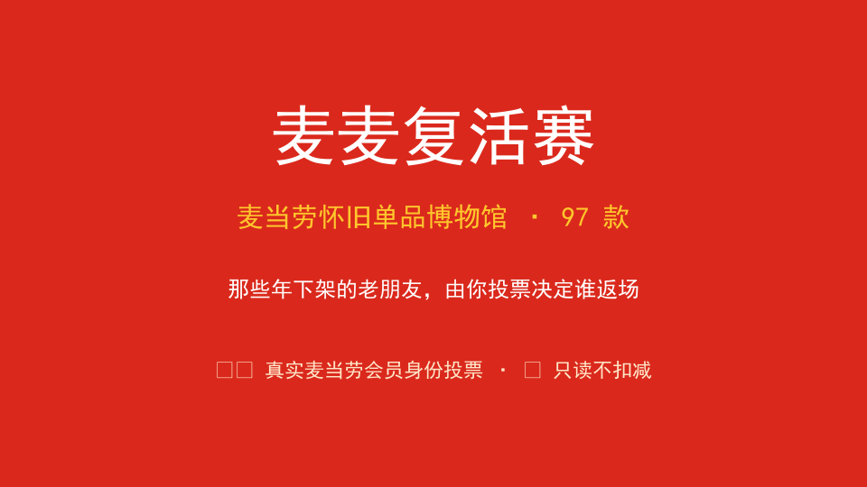

# 麦麦复活赛（McRevival）

> 麦当劳 × 腾讯 WorkBuddy 程序员创意开发大赛 · 参赛作品
> 用一次"投票"，让那些年我们爱过的麦当劳老产品，打一场复活赛。



> ### ⚠️ 先看：三条能力边界（别把"设计目标"当成"已上线功能"）
>
> 本 README 只按**代码现状**描述能力。以下三点是文档曾经含糊、也最容易被误读的地方：
>
> 1. **公开网页投不出真实票。** `web/serve.py` 在公开站点上把投票能力声明为"不可用"（`POST /api/vote` =
>    **501**）。真实投票只能在**你自己的机器**上用 CLI / WorkBuddy Skill 完成，网页不被信任代为投票。
>    → 见「三·补、两种运行模式」与「4.x.1 投票能力边界」。
> 2. **去重的作用域是"单个本地账本实例"，不是全局。** 同一会员在同一份 `votes.json` 内对同一单品只计一次；
>    **跨实例 / 跨用户的全局去重没有实现**（共享榜刻意匿名，因此无法判断"两票是不是同一个人"）。
>    → 见「五、投票规则」。
> 3. **共享榜的输入源目前只有"持有 GitHub 写权限凭证的那一方"。** 聚合时只统计信任锚点账号自身发的评论，
>    所以外部参与者目前**无法**把自己的票送进本仓库这张榜 —— 想让自己的票进榜需要 fork 自建并配置自己的
>    机器人凭证与 Issue。→ 见「3.3」。

---

## 一、项目介绍

**麦麦复活赛**是一个"怀旧单品许愿池"：它把麦当劳历史上那些已下架 / 限定的经典产品（蘸酱、甜品、主食、小食）收进一座线上博物馆，并让参与者**在本机用自己的真实麦当劳会员身份**为它们投票（公开网页不代为投票，见上方第 1 条），
最终产出一份"复活榜"，作为"用户是否希望某款产品返场"的意愿信号。

核心特点：

- **真实使用麦当劳 MCP**：通过官方 `mcp.mcd.cn` 的 Streamable HTTP 接口，真实调用多个**只读**工具（`query-my-account` 读积分、`query-meals` 拉在售、`list-nutrition-foods` 营养库、`campaign-calendar` 活动日历、`mall-points-products` 积分商城、`query-lottery-info` 抽奖信息、`delivery-query-stores` 附近门店等）。所有调用统一收口到 `scripts/mcd_data.py` 的 `safe_call` 白名单——**8 个写/交易类工具（下单、领券、抽奖、建地址…）一律被硬拦截**，从调用层守住"仅读取、绝不扣减"的红线。
- **强身份投票**：每一票都必须现场通过麦当劳会员身份校验（服务端自己调 `query-my-account` 解析出会员唯一标识），并且**不接受网页传来的任何会员标识**（伪造会员号一律 400 拒绝）。去重的作用域与未实现边界见上方第 2 条与「五、投票规则」。
- **透明可核**：所有怀旧单品均经联网核实（麦当劳中国官网及公开报道），标注下架/限定状态，不杜撰事实。
- **本地前端页面**：`web/` 下提供麦当劳红黄风格的「投票大厅 + 复活榜」交互页，纯前端 + 一个零依赖本地服务（`web/serve.py`，仅标准库）即可运行。

> 说明：复活赛是"用户意愿趣味收集，**不代表官方返场承诺**"。价格 / 餐品 / 供应状态均标注"以麦当劳官方渠道实时结果为准"。

---

## 二、功能特性

| 功能 | 说明 |
|------|------|
| 怀旧博物馆 | 浏览已核实的麦当劳下架 / 限定单品名录 |
| 麦当劳会员投票 | 仅会员可投；1 票基础（确认身份）+ 每 100 积分 1 票（额外），无积分仅 1 票 |
| 强身份去重 | 以服务端自己调 `query-my-account` 得到的会员唯一标识为去重主键，每会员每单品仅一次；**作用域为单个本地账本实例**（跨实例全局去重未实现，见「五、投票规则」） |
| 在售 vs 怀旧 | 调用 `query-meals` 拉实时在售菜单，与本地博物馆对照 |
| 复活榜 | 匿名票数（票种/增量/省份/日期）回流 GitHub Issue 后由站点只读聚合；**仅计信任锚点账号自身发的评论**，他人无法灌票 + 本地兜底，支持省份维度（34 个省级行政区受控枚举）。输入源限制见下方「3.3」 |
| 麦麦现在（实时只读增强） | 「麦当劳现在」页：营销活动日历 / 积分商城可兑换 / 积分抽奖信息 / 在售对比 / 附近门店，全部来自麦当劳 MCP 只读接口，实时更新 |
| 只读红线 | 所有 MCP 调用经 `mcd_data.safe_call` 白名单，8 个写/交易工具（`create-order` / `draw-lottery` / `auto-bind-coupons` / `delivery-create-address` / `calculate-price` / `party-order-create` / `mall-create-order` / `cancel-order`）一律拒绝 |
| 拉票卡 | 生成社媒分享文案，为作品导流 |

---

## 三、安装方法

### 3.1 环境要求

- Python 3.8+（仅使用标准库，无需 `pip install`）
- 已安装 [WorkBuddy](https://www.workbuddy.cn)，并将本仓库作为 Skill 引入

### 3.2 获取麦当劳 MCP Token（必填，禁止明文）

1. 从麦当劳 MCP 服务方获取你的 `MCD_MCP_TOKEN`（Bearer Token）。
2. **不要**把 Token 写进任何文件。通过环境变量注入：

```bash
export MCD_MCP_TOKEN="你的Token"
```

3. 配置 MCP（参考 `mcp-config.example.json`，仅含占位符，复制为 `mcp-config.json` 并填入变量名即可）：

```bash
cp mcp-config.example.json mcp-config.json
# 编辑 mcp-config.json，确保 token 字段为 ${MCD_MCP_TOKEN} 之类的环境变量占位符
```

### 3.3 匿名共享榜（GitHub Issue 后端，零服务器）与它的输入范围

持有 GitHub 写权限凭证的那一方（当前为本仓库作者）在投票成功后，会把**匿名**票回流到对应单品的
GitHub Issue 评论（仅含票种/增量/省份/日期，**不含任何会员标识**）。公开站点只读这些评论，聚合成"复活榜"。

> **输入范围（如实说明，别读成"所有人往同一张榜上写"）**：聚合只统计信任锚点账号自身发布的评论
> （见下方信任模型），因此**能进入本仓库这张榜的，目前只有持有该写权限凭证的一方**。
> 第三方若想让自己的票进榜，需 fork 后自建 Issue 并配置自己的 `GITHUB_BOT_LOGIN` / `GITHUB_TOKEN`
> （`report_github.py setup` 已支持），届时他的榜由他自己的凭证回填 ——
> 这是一条**可自托管、但当前单点运行**的链路。

**信任模型（防伪造刷票）**：聚合时**只统计机器人自身账号**发布的投票评论（以 `GITHUB_BOT_LOGIN` 为信任锚点），
他人无法在 Issue 下伪造 `vote ...` 灌票。这是本作品"透明可核"的硬保障。

作者/机器人一次性建 Issue：

```bash
export GITHUB_REPO="owner/repo"
export GITHUB_TOKEN="你的GitHubToken"   # 仅作者/机器人持有，绝不提交
python3 scripts/report_github.py setup --repo owner/repo
```

> 未配置 GitHub 后端时，投票与榜单在本地照常运行；只是"全民聚合榜"为空。

---

## 三·补、两种运行模式（先选一个再看命令）

| | **模式 A · 公开演示** | **模式 B · 真实投票** |
|---|---|---|
| 启动 | `MCMUSEUM_DEMO=1 python3 web/serve.py` | CLI / WorkBuddy Skill（在你本机） |
| 需要 Token | **不需要任何 Token** | 需要你自己的 `MCD_MCP_TOKEN` |
| 能做什么 | 浏览 81 款单品、单品详情、看演示榜单 | 用真实麦当劳会员身份投票 |
| 页面标识 | 顶部常驻黄色「**演示数据**」横幅 + 榜单标注「⚠️ 演示数据 · 示例票数」 | 无横幅；榜单标注真实来源 |
| 投票入口 | 灰色「🔒 演示模式」，`POST /api/vote` = **501** | CLI 真实投票；回执区分"本地成功 / 共享榜同步失败" |
| 会进正式 GitHub 榜吗 | **永远不会**（该模式没有写票入口） | 会（除非加 `MCMUSEUM_SHARED_BOARD=0` 沙箱开关） |

演示数据来自仓库内置的 `data/demo_votes.json`（带 `_demo: true` 标记），与真实账本
`data/votes.json` 完全隔离；演示模式只**读**它，从不写它。

只想快速试玩或做评审演示 → 用模式 A，一条命令、零凭证。
完整复现流程（含"投票前后看榜""验证重复投票被拦截""清理测试数据"）见 **[docs/DEMO_GUIDE.md](docs/DEMO_GUIDE.md)**。

---

## 四、使用示例

```bash
# 1) 逛博物馆
python3 scripts/revival.py museum

# 2) 用麦当劳会员身份投票（需 MCD_MCP_TOKEN）
#    票数 = 1（确认身份的基础票） + 积分 // 100（每 100 积分 1 票）
python3 scripts/revival.py vote --product sakura_mcfloat --from-mcp
#    省份维度：不传 --province 时自动识别（从麦当劳账号地址解析，仅取省级、不保存地址）
#    识别不到则计入「全国」；也可手动指定（34 个省级行政区受控枚举，防脏数据）
python3 scripts/revival.py vote --product sakura_mcfloat --from-mcp --province 上海
#    验证自动识别是否可用（脱敏输出，不打印地址）：
python3 scripts/detect_province.py

# 3) 在售 vs 怀旧 对比（真实拉取 query-meals）
python3 scripts/revival.py meals --from-mcp

# 4) 看榜
python3 scripts/revival.py ranking --top 10
python3 scripts/revival.py ranking --top 10 --province 上海   # 按省份看榜

# 5) 生成拉票卡
python3 scripts/revival.py share --product sakura_mcfloat

# 6) 生成可视化榜单（输出 web/leaderboard.json）
python3 scripts/build_leaderboard.py
#    然后用任意静态服务器打开 web/leaderboard.html
```

在 WorkBuddy 中，直接对 Skill 说"我想给樱花麦旋风投票 / 看看复活榜"，Skill 会自动调用上述脚本。

### 4.x 本地前端页面（投票大厅 + 复活榜，麦当劳红黄风）

无需第三方框架，仅用 Python 标准库起一个本地服务即可：

```bash
python3 web/serve.py                                  # 浏览 / 看榜；在线投票关闭（默认安全）
MCMUSEUM_ENABLE_SERVER_VOTE=1 python3 web/serve.py    # 本机可信环境：额外开启网页投票
# 浏览器打开 http://127.0.0.1:8000
```

页面提供两个视图：

- **投票大厅**：浏览 81 款怀旧单品卡片（其中 68 款在投票池内）。
- **复活榜**：实时展示各单品累计票数（带进度条与 🥇🥈🥉）。

#### 4.x.1 投票能力边界（先读这段，再谈"能不能在网页上投票"）

真实投票需要验证**访客自己**的麦当劳会员身份。公开部署的服务器拿不到、也不应该持有任何人的
会员凭证，所以本作品把能力边界做成了**可验证的硬约束**，而不是文案承诺：

| 部署形态 | 浏览 / 看榜 | 网页在线投票 | `POST /api/vote` 行为 |
|---|---|---|---|
| 公开站点（默认） | ✅ 可用 | ❌ 不可用 | **HTTP 501** `vote_not_supported_here`，按钮置灰并给出本机 CLI |
| 显式开启但无会员 Token | ✅ 可用 | ❌ 不可用 | **HTTP 503** `member_auth_unavailable` |
| 可信本机（`MCMUSEUM_ENABLE_SERVER_VOTE=1` + 你自己的 Token） | ✅ 可用 | ✅ 可用 | 与 CLI 走同一个 `revival.record_vote`，真实调用 `query-my-account` |

三条不可绕过的规则：

1. **不接受客户端提交的会员标识**：请求体里出现 `member*` / `card*` / `openid` / `token` 等字段一律 **400**
   `client_identity_not_accepted`。服务端只信任自己调用 `query-my-account` 得到的身份。
2. **`from_mcp=True` 不等于"已认证"**：它只表示"允许真的去调 `query-my-account` 认证"，解析不出会员唯一标识就拒绝投票。
3. **绝不假成功**：投票失败按语义返回 401（认证失败）/ 409（重复投票）/ 400（参数错误）；
   GitHub 共享榜回流失败时在响应里如实给出 `shared_board_reported: false` + 原因，前端会明确提示"未回流共享榜"。

前端通过 `GET /api/vote-capabilities` 拉取能力声明，不可用时把按钮渲染为「🔒 本机投票」灰态并弹出本机投票指引
（`python scripts/revival.py vote --product <单品id> --from-mcp`），**不会出现"点了显示投票成功但根本没投"**。

> 前端页与 Skill / CLI 共用同一套 `revival.py` 逻辑，投票数据写入 `data/votes.json`，三种入口完全一致。

#### 4.x.2 部署上线（公开站点 + 实时共享榜）

公开站点只负责"展示博物馆 + 实时共享榜"，**不持有任何 Token**。一张票要出现在站点上，前提是它
**已经被持有 GitHub 写权限凭证的一方回流到 Issue 评论** —— 当前只有本仓库作者这一个来源（见「3.3」）。
所以在第三方自建之前，公开站点展示的是**作者侧已回流的票**；外部参与者想让自己的票出现在公开榜上，
需要按「3.3」fork 一份并配置自己的机器人凭证与 Issue。

用 `sites` 技能把 `web/` 作为「静态页 + 标准库服务」部署（入口 `web/serve.py`，零第三方依赖），并配置环境变量：

```bash
LEADERBOARD_SOURCE=github         # 榜单走 GitHub 评论聚合（只看信任锚点账号发的评论，防伪造灌票）
GITHUB_BOT_LOGIN=你的GitHub用户名  # 信任锚点；公开部署无需 GITHUB_TOKEN，只读公开 Issue 即可
# ⚠️ 切勿在公开站点配置 MCD_MCP_TOKEN / GITHUB_TOKEN
# ⚠️ 切勿在公开站点设置 MCMUSEUM_ENABLE_SERVER_VOTE=1（那等于让服务端用一份 Token 替所有人投票）
```

启动日志会打印当前实例的投票能力（✅ / ❌ + code），可直接核对。

> 数据流向：本机 / WorkBuddy 投票（自身麦当劳账号，本地实名去重）→ **由持有 GitHub 写权限凭证的一方**匿名回流 Issue
> → 公开站点只读聚合展示。这条链路**不是**"任何人投票都能自动上公开榜"，限制见「3.3」。
> 不依赖任何自建服务器，零运维成本；公开站点只读公开数据，无需在服务端存放任何密钥。

---

## 五、投票规则（重要）

- **仅麦当劳会员可投票**：未连接麦当劳账号（无有效 `MCD_MCP_TOKEN` / `query-my-account` 无法返回会员标识）时，投票被拒绝——本作品**已取消 WorkBuddy 账号 / 匿名降级投票**。
- **票数构成**：确认会员身份 = 1 基础票；额外票数 = `积分 ÷ 100`（向下取整）。无积分即仅 1 票。
  每次投票的结果消息与前端都会**逐项展示**「基础票 / 积分票 / 合计票重」——积分加权反映的是会员在麦当劳生态内的长期活跃度，作为产品「复活意愿强度」的趣味加成；**一人对同一单品只有一次投票机会**，加权不改变「一人一票」的原则。
- **强身份去重（作用域，边界说清楚）**：
  - **已实现**：每个 `revival.py` 运行实例内，所有投票都经 `record_vote` 统一入口，按麦当劳会员唯一标识
    （会员号 / openid / 卡号等）在该实例的 `votes.json` 里去重——同一会员对同一单品只能计一次。
  - **未实现（不假装已实现）**：**跨实例 / 跨用户的全局去重目前做不到**。共享榜是**匿名票数聚合**
    （只有票种 / 增量 / 省份 / 日期，刻意不含任何会员标识，否则就泄露身份了），因此无法在共享榜层面
    判断"这两票是不是同一个人"。若同一会员在两份独立部署里各投一次，共享榜会各计一次。
    这是"匿名性"与"全局去重"不可兼得的取舍，本作品选择**保护用户身份**，并在此如实声明该边界。
  - **防伪造仍然成立**：共享榜仅信任机器人账号的评论（以 `GITHUB_BOT_LOGIN` 为锚点），
    普通用户自己在 Issue 下写 `vote ...` 不计入；票种还必须在白名单 `mcp` / `backfill` 内。
- **仅读取**：积分仅用于换算票数，绝不调用任何扣减 / 下单接口，不触碰用户资金。
- **遵守反刷榜**：不提供任何机器人 / 脚本批量刷票路径。

### 5.1 自己验证这些边界（三条命令）

```bash
python3 scripts/test_scenarios.py   # 15 个场景：产品读取 / 无 Token / 并发双投 / GitHub 故障 / 演示隔离 …
python3 scripts/smoke_http.py       # 端到端：真起 4 种部署形态的服务做 HTTP 断言
python3 scripts/selfcheck.py        # 全项目自检：内容充分性 + MCP 只读红线 + 能力边界 + 账本健壮性
```

`smoke_http.py` 会依次拉起四种部署形态的服务并断言：

| 场景 | 断言 |
|---|---|
| 公开站点 | 浏览 200、`/api/vote-capabilities` 返回不可用、`POST /api/vote` = **501** 且 `ok=false, val=0` |
| 开启投票但无 Token | `POST /api/vote` = **503**、浏览仍 200 |
| 可信本机 + 伪造会员标识 | `POST /api/vote` = **400** `client_identity_not_accepted`（不会走到真实投票） |
| 公开演示模式 | 无 Token 可浏览、`source=demo`、`POST /api/vote` = **501** `demo_mode_vote_disabled` |

`test_scenarios.py` 的每个用例都标注性质：**[MOCK]** 用 mock 隔离麦当劳 MCP 与 GitHub，
在临时目录操作副本账本（**不写真实账本、不碰 GitHub**），离线可复现；
**[REAL]** 真实集成默认**跳过**并显示 ⏭️（需加 `--real` 才执行），**跳过不算通过**。
`--real` 只做只读验证（认证一次 + 读一次共享榜），不会投票、不会发评论。

本机实测（2026-10-13）：`test_scenarios.py` ✅16 / ❌0 / ⏭️2，加 `--real` 后 ✅18 / ❌0 / ⏭️0，
`smoke_http.py` ✅15 / ❌0，`selfcheck.py` ✅63 / ❌0，另有 `image_research.py verify` 校验图片档案。
> 数字会随新增检查而变，以你自己跑出来的输出为准。

**演示相关**：评审一键复现流程见 [docs/DEMO_GUIDE.md](docs/DEMO_GUIDE.md)，
60–90 秒演示脚本见 [docs/DEMO_SCRIPT.md](docs/DEMO_SCRIPT.md)。
现有 `docs/demo.gif` 是 960×540 / 146 帧 / **约 22 秒**的浏览片段，
**不能**单独代表完整演示（未覆盖投票、去重与共享榜区分），需按脚本补录。

---

## 五·补、图片档案（覆盖率与图片状态，如实公开）

图片与产品元数据的关系**已迁出前端**：原先硬编码在 `web/app.js` 的 `HALL_IMG` 常量里（无法追溯来源），
现在每款产品在 `data/nostalgic_products.json` 里带七个字段：

| 字段 | 用途 |
|---|---|
| `image` | 站点使用的本地图片路径 |
| `image_status` | `verified` / `unverified` / `reconstruction` / `missing` |
| `image_source_url` `image_source_name` | 出处网页与来源类型（官方 / 媒体 / 消费者 / AI 复原） |
| `image_rights` `image_confidence` `image_note` | 授权情况、匹配置信度、年份/包装/复原说明 |

```bash
python3 scripts/image_research.py plan        # 生成待补图清单（CSV + JSON 检索词）
python3 scripts/image_research.py verify      # 校验档案：缺字段 / 非法枚举 / 断链 / 重复 / 冒充已核实
python3 scripts/image_research.py report      # 覆盖率与待处理清单
```

**当前覆盖率：26 / 81 = 32%**，且这 26 张**全部是 `unverified`** ——
它们是仓库早期搜集的图，原始出处与授权没有留存，所以在补齐 provenance 之前**不沿用"已核实"的旧注释**。

规则（既写进脚本，也写进流程）：`verified` 必须能给出出处，否则 `verify` 直接判错；
AI 复原图一律 `reconstruction` 且必须写说明，**绝不**冒充历史实拍；没有明确许可的图不下载、不入库；
缺图用统一占位卡，不拿别的产品图顶替。**一期不下载任何图片** —— 下载与 WebP 转换排在二期。
详见 [docs/IMAGE_PLAN.md](docs/IMAGE_PLAN.md)。

---

## 六、目标用户

- **麦门情怀用户**：想念某款下架/限定产品，想用一票表达"求返场"。
- **参赛开发者 / 评审**：验证"真实使用麦当劳 MCP""会员身份去重（单实例作用域）""共享榜不可伪造""透明可核"的落地情况 —— 未被实现的边界在「五、投票规则」里逐条列出，不假装已做。
- **麦当劳 / 品牌方**：将榜单作为"用户意愿"的轻量、低成本的真实信号参考。

---

## 七、文件结构

```
McMuseum/
├── README.md                # 本文件
├── SKILL.md                 # WorkBuddy Skill 定义（流程 / MCP 清单 / 反作弊）
├── CONTEST_DECLARATION.md   # 参赛声明（内容不可改）
├── MCP_INTEGRATION.md       # MCP 接入说明
├── workbuddy.md             # WorkBuddy 专项奖励上下文记录
├── mcp-config.example.json  # MCP 配置示例（仅占位符）
├── scripts/
│   ├── revival.py           # 投票 / 榜单 / 博物馆引擎
│   ├── mcp_client.py        # 麦当劳 MCP 真实调用客户端（只读）
│   ├── report_github.py      # 可选：GitHub 后端匿名聚合
│   ├── build_leaderboard.py  # 生成可视化榜单数据
│   ├── selfcheck.py         # 一键自检（内容充分性 + 只读红线 + 能力边界 + 账本健壮性）
│   ├── image_research.py     # 图片档案采集/校验（plan/bootstrap/verify/report；一期不下载任何图）
│   ├── smoke_http.py        # HTTP 端到端冒烟：真起 4 种部署形态验证能力边界
│   └── test_scenarios.py    # 16 个场景测试（[MOCK] 离线可复现 / [REAL] 默认跳过）
├── docs/
│   ├── DEMO_GUIDE.md        # 评审可复现流程（模式 A/B、看榜、去重验证、清理测试数据）
│   ├── DEMO_SCRIPT.md       # 60–90 秒演示脚本 + 现有 demo.gif 的评估
│   ├── demo.gif             # 现有演示片段（约 22 秒，仅覆盖浏览）
│   └── promotion.md         # 宣传渠道整理
├── data/
│   ├── nostalgic_products.json  # 怀旧单品名录（已核实）
│   └── votes.json               # 本地投票累计（运行时生成）
└── web/
    ├── serve.py             # 本地前端服务（零依赖，包裹 revival.py 暴露 JSON API）
    ├── index.html           # 前端页：投票大厅 + 复活榜（麦当劳红黄风）
    ├── style.css            # 前端样式
    ├── app.js               # 前端逻辑（投票交互 / 看榜）
    ├── leaderboard.html     # 静态榜单占位页（由 build_leaderboard.py 数据驱动）
    └── leaderboard.json     # 由 build_leaderboard.py 生成
```

---

## 八、合规与声明

- 本作品遵守赛事规则：**真实使用麦当劳 MCP**；原创内容；不含对麦当劳的贬低 / 与其他品牌对比 / 宣扬不健康饮食；不含任何明文 Token 或个人敏感信息。
- 怀旧单品均标注下架 / 限定状态，并经联网核实；`verified=false` 项赛前需人工确认或移除。
- 积分仅读取、不扣减；投票需现场完成会员身份校验，并在**单个本地账本实例**内强去重（全局去重未实现，见「五」）。
- 详见 `CONTEST_DECLARATION.md`（与官方逐字一致，不可修改）。

---

## 九、参赛信息

- 赛事：麦当劳 × 腾讯 WorkBuddy 程序员创意开发大赛
- 仓库：`peterpark12138/McMuseum`
- 排名口径：以公开 Star 为准（详见赛事官方仓库规则）
